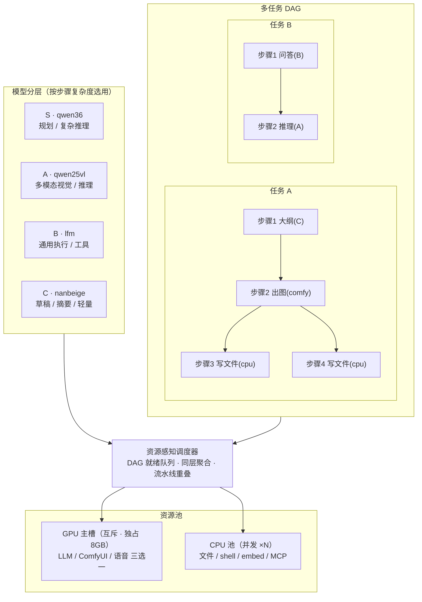

# 模型调度架构方案

> 目标：在 8GB 显存（GPU 服务互斥）的硬约束下，减少服务切换、杜绝显存误判导致的 OOM、并让无依赖步骤并行。
> 创建 2026-10-24 ｜ 更新 2026-11-04（v2：同步已落地的调度内核与实测数据）
> 硬件基线：RTX 5060 Laptop 8GB（实测 nvidia-smi 总显存 8151MB，桌面常驻约占 1GB）
> **当前状态**：单 run 内 DAG 调度 + 同驻留聚合 + 显存/内存准入守门已落地；模型分层、CPU 并发池、跨任务并行、监视器多任务视图未做。
> 相关源码：[orchestrator.py](agent/orchestrator.py)、[planner.py](agent/planner.py)、[llm.py](agent/llm.py)、[services.py](agent/services.py)、[monitor.py](agent/monitor.py)、模型注册表 [models.json](../scripts/llama_cpp/models.json)

---

## 一、现状诊断

初版诊断的 4 个瓶颈，以及 v2 更新后的实际状态：

| # | 瓶颈 | 现状 | 影响 |
|---|------|------|------|
| 1 | **单模型贯穿** | 整个 run 只有一个 `model_key`，所有文本步骤都用同一个模型 | 简单步骤也吃旗舰模型的延迟（v2 暂缓分层，理由见 2.1） |
| 2 | **全局串行锁** | 流水线内部已改为依赖感知调度，但 `exec_lock` 仍是全局互斥 | 任务内可以聚合，跨任务仍要排队 |
| 3 | **服务"先停后起"** | 已改为同资源聚合，只有资源相位变化才切换服务 | 每任务从「按步骤切换」降到 1–2 次切换 |
| 4 | **监视器只看单 run** | `snapshot()` 只取 `latest_run`，任务汇总是历史账本 | 看不到多任务实时并行状态（未改） |

**硬件硬约束**：8GB 显存，LLM / ComfyUI / 语音三者互斥，**不可能两个 GPU 模型真正并发**。但这不等于只能串行——CPU 步骤（文件、shell、embed、MCP）可以和 GPU 步骤重叠，这就是提速空间。

---

## 二、总体方案：四层优化

| 层 | 内容 | 状态 |
|----|------|------|
| 第一层 | 模型分层（按复杂度选 S/A/B/C） | ⏸ 暂缓，见 2.1 |
| 第二层 | DAG + 资源标注（`resource` / `depends_on`） | ✅ 已落地 |
| 第三层 | 资源池调度（GPU 主槽互斥 + CPU 池并发） | ◐ 单 run 已落地，跨任务/CPU 池未做 |
| 第四层 | 监视器多任务视图 | ⬜ 待做 |
| 补充 | 显存/内存准入守门（v2 新增） | ✅ 已落地，见 2.6 |

### 2.1 第一层：模型分层（v2 暂缓，原方案不成立）

原方案「默认 B 档、按步选模型」在 8GB 显存 + 32GB 内存上不能成立，两个原因：

1. **质量风险**：路由/规划出错不可自愈，把 `complexity` 打标交给小模型，等于把最贵的决策交给最弱的模型；nanbeige 3B 的定位是摘要/草稿，不适合决策。
2. **资源风险**：常驻一个小模型会和 ComfyUI 的显存、以及 qwen36 的 22GB `--cpu-moe` 内存直接冲突。生成阶段本来就没有 LLM 可用，额外常驻只会挤占后续加载空间。

**修正规则（按错误代价分档，而不是按步骤复杂度）**：

| 决策 | 出错代价 | 当前实现 |
|------|----------|----------|
| 任务路由 | 低，可重试 | 关键词规则（[task_router.py](agent/task_router.py)），未命中才问当前在线模型 |
| 规划 / 步骤决策 | 高 | 沿用整个 run 的 `model_key`（通常 qwen36），不降档 |
| 生成阶段内的推进 | — | 确定性调度 + 规则，不调用任何 LLM |
| 产物质检 | 中 | 生成结束后切回主模型做一次 |

若将来确要做分层，前提是「CPU-only、小模型、按需拉起、用完即杀、只做分类/摘要」，不做常驻服务。`model_tiers` 配置暂不引入。

### 2.2 第二层：DAG + 资源标注

把规划产物从"线性步骤列表"升级为**带依赖的 DAG**。`planner.py` 的 `PlanStep` 扩展字段：

**已落地**（[planner.py](agent/planner.py)）：

```python
@dataclass
class PlanStep:
    goal: str
    tool: str = "none"
    resource: str = ""                  # 空 = 按 tool 推断；不在白名单的取值不采信
    depends_on: list[int] = field(default_factory=list)  # 只允许指向前序步骤

    def resource_key(self) -> str:      # 显式 resource 合法才用，否则按工具推断
        ...
```

`parse_plan` 的护栏：`depends_on` 只保留 `0 <= k < 当前步下标` 的整数，越界、自环、非数字直接丢弃，从解析层就杜绝死锁。

规划提示词要求模型输出：

```json
{"goal":"生成大纲","tool":"none","resource":"gpu_llm","depends_on":[]}
```

`resource` 字段决定该步骤进哪个资源池：
- `gpu_llm`：需要 LLM 推理（吃 GPU 主槽）
- `comfy`：ComfyUI 生成图/视频/音乐（吃 GPU 主槽）
- `voice`：TTS/ASR（吃 GPU 主槽，脚本跑完自释放）
- `cpu`：文件读写、shell、embed、rerank（进 CPU 池，可并发）
- `mcp`：MCP 工具调用（`mcp_<server>_<tool>`），stdio 子进程，同样只吃 CPU，可与 GPU 步骤重叠

**MCP 节点按需挂载**：初始不挂载任何 MCP server（`enabled` 全为 false）。任务开始时由
[mcp_router.py](agent/mcp_router.py) 按关键词挑出需要的 server（单任务最多 2 个）并即时挂载，
挂载后常驻复用。这样工具清单不会挤占上下文，也避免十几个子进程同时开着。
MCP 步骤在调度里标为 `resource=mcp`，与 `cpu` 同池并发。

### 2.3 第三层：资源池调度（单 run 已落地，跨任务未做）

**已落地**（[orchestrator.py](agent/orchestrator.py) `_exec_steps`）：单 run 内维护就绪队列，按 `depends_on` 挑选步骤；就绪步骤里优先选与当前驻留服务同资源的（CPU/MCP 视为兼容，不改变驻留）。依赖不可满足时退回最小下标顺序，保证不死锁；`scheduler.reorder=false` 可恢复严格顺序。每次提前都发 `phase` 事件说明原因。

**未做**：下面是原计划的双池（跨任务 GPU 主槽 + CPU 并发池），目前 `exec_lock` 仍全局互斥。

- **GPU 主槽（互斥）**：同一时刻只跑一个 —— LLM / ComfyUI / 语音三选一。就绪的 GPU 步骤按**模型层级聚合**执行。
- **CPU 池（并发 N）**：`ThreadPoolExecutor(max_workers=N)`，N 由配置 `scheduler.cpu_workers` 控制（默认 3）。`cpu` 与 `mcp` 两类步骤都进这个池。

目标上由此实现三种并行（当前均未落地，`exec_lock` 未拆）：

| 并行类型 | 说明 |
|----------|------|
| **任务间并行** | 任务 A 的 ComfyUI 出图（GPU）时，任务 B 的文件写入（CPU）同时跑 |
| **任务内并行** | 任务 A 里无依赖的步骤 3、4（写文件）并发执行 |
| **流水线重叠** | 步骤 2（LLM 生成）产出后，步骤 3（写文件 CPU）立刻开始；若步骤 4 是 GPU 且不依赖步骤 3，可同时抢占 GPU 槽——CPU 写盘与 GPU 推理重叠 |

调度伪代码：

```python
def schedule(runs, cancel):
    ready = [step for run in runs for step in run.plan.steps
             if step.deps_satisfied() and not step.done]
    while ready and not cancel.is_set():
        # GPU 主槽空闲 → 取一个 GPU 步骤（同层聚合，减少切换）
        if gpu_slot.free():
            gpu_step = pick_by_tier(ready, resource in {gpu_llm, comfy, voice})
            gpu_slot.run(gpu_step)
        # CPU 池有空闲 → 取一个 CPU 步骤
        if cpu_pool.has_slot():
            cpu_step = pick(ready, resource == cpu)
            cpu_pool.submit(cpu_step)
        # 等待任一完成，解锁后继，刷新 ready
        wait_any()
```

### 2.4 模型切换优化（部分落地）

**已落地**的是「服务切换」层面的聚合，不是「模型层级」层面的聚合：按 `gpu_llm / comfy / voice` 三类资源聚拢，同资源步骤连续跑完再换服务。

举例：`写大纲 → 出图 → 写旁白 → 出图`，实际执行顺序是 `0,2,1,3`，只切一次而不是三次。

**未做**的是按 S/A/B/C 层级聚合（依赖 2.1，暂缓）。分层一旦引入，切换目标就从「服务」变成「服务 + 模型」，收益更小、风险更大，因此优先级排在 CPU 并发之后。

### 2.5 第四层：监视器多任务视图（未实现）

[monitor.py](agent/monitor.py) 改造：

- **顶部资源条**：GPU 主槽当前占用者 + 等待队列、CPU 池使用率（已用/总数）
- **多任务卡片网格**：每个运行中任务一张卡，卡内画 DAG（节点 + 依赖箭头，不是线性 →）
- **节点状态**：`pending / ready / running(哪个资源) / done / failed`
- **模型切换时间线**：什么时候从 B 切到 A、切换耗时

### 2.6 新增：显存/内存准入守门（已落地）

原方案只写了"GPU 主槽互斥"，没有回答"启动前怎么确认装得下"。8GB 卡上这一点比调度更重要：

- [services.py](agent/services.py) 新增 `gpu_memory()`（nvidia-smi，3 秒缓存）、`ram_status()`（psutil）、`check_budget(vram_mb, ram_mb)`
- [orchestrator.py](agent/orchestrator.py) 在 `stop_llm` 之后、`ensure_comfy` 之前检查；停服务后**强制现读**，不吃缓存旧值
- 指标读不到时放行（不能因探测失败卡死主流程）；不足时报错并给出"需多少 / 空多少 / 共多少"
- 阈值见 `scheduler.comfy_vram_mb = 6400`：这是"没有别的进程霸占显存"的下限，不是 ComfyUI 的真实峰值

实测：本机总显存 8151MB、桌面常驻约占 1GB。定 7800 会每次都误拦，定 6400 才能区分"真的被占用"和"正常可用"。

---

## 三、调度架构图


*图：模型分层 → 资源感知调度器 → GPU 主槽 / CPU 池双资源池。图源文件 [assets/scheduler-architecture.svg](assets/scheduler-architecture.svg)（可缩放）*

> **注意**：这张图描述的是目标架构，不是当前实现。已落地部分只有「单 run 内 DAG 调度 + 同资源聚合 + 预算守门」；模型分层、CPU 并发池、跨任务共享 GPU 主槽仍未做。



**图注**：
- 模型分层按 `complexity` 映射到 S/A/B/C，规划阶段给每步打标
- 多任务的 DAG 步骤汇总到全局就绪队列
- 调度器把 GPU 步骤分发到互斥的 GPU 主槽，CPU 步骤分发到并发的 CPU 池
- GPU 主槽内同层模型聚合执行，减少切换开销

---

## 四、数据结构变更

### 4.1 PlanStep 扩展（planner.py）

```python
@dataclass
class PlanStep:
    goal: str
    tool: str = "none"
    resource: str = ""                  # 新增；空 = 按 tool 推断
    depends_on: list[int] = field(default_factory=list)  # 新增；只允许指向前序步骤
```

### 4.2 资源类型常量

```python
# 实际定义在 planner.py，orchestrator 直接复用
RES_LLM = "gpu_llm"
RES_COMFY = "comfy"
RES_VOICE = "voice"
RES_CPU = "cpu"
RES_MCP = "mcp"

GPU_RESOURCES = {RES_LLM, RES_COMFY, RES_VOICE}  # 互斥

def resource_of_tool(tool: str) -> str:
    """mcp_* → mcp；generate_* → comfy；tts/asr → voice；none → gpu_llm；其余 → cpu"""
```

### 4.3 复杂度到模型层级的映射（未实现，暂缓）

随 2.1 一并暂缓。当前 `PlanStep` 不带 `complexity`，调度只按资源聚合，不按模型层级降档。

### 4.4 PlannedRun 扩展（未实现）

决定不加 `active_step` / `resource_usage`：步骤状态由事件流（`step_start` / `step_done` / `phase`）表达，`i` 字段就是步骤下标；再加一份冗余状态只会制造双写不一致。

### 4.5 调度配置（新增）

```json
"scheduler": {
  "reorder": true,
  "guard": true,
  "comfy_vram_mb": 6400,
  "comfy_ram_mb": 12000
}
```

---

## 五、落地路线

| 阶段 | 内容 | 改动文件 | 状态 |
|------|------|----------|------|
| **P0 资源标注 + 预算守门** | `resource` / `depends_on`；解析护栏；显存+内存准入；端口未监听时跳过 psutil 扫描 | `planner.py`、`services.py`、`orchestrator.py`、`agent.json` | ✅ 已落地（v2） |
| **P0.5 同驻留优先调度** | 替换 `for` 循环为依赖感知的就绪队列；同资源聚合；依赖不可满足时回退顺序 | `orchestrator.py` | ✅ 已落地（v2） |
| **P1 模型分层** | 按 `complexity` 选 S/A/B/C | `agent.json`、`planner.py`、`orchestrator.py` | ⏸ 暂缓（见 2.1，8GB 显存 + 质量风险不成立） |
| **P2 CPU 并发池** | `cpu` / `mcp` 步骤进线程池，与 GPU 步骤重叠 | `orchestrator.py` | ⬜ 待做（收益明确，风险中等） |
| **P3 跨任务并行** | 拆 `exec_lock` 为 GPU 主槽锁 + CPU 池；全局就绪队列 | `orchestrator.py`、`webui.py` | ⬜ 待做（改动最大） |
| **P4 监视器多任务** | 资源条 + 多任务 DAG 卡片 + 切换时间线 | `monitor.py`、`webui.py` | ⬜ 待做 |

**修正后的优先级**：P2（CPU 并发，收益确定且不碰 GPU 互斥）→ P4（先让调度可见）→ P3（跨任务）→ P1（分层，最后再评估）。原方案把 P1 排第一，理由是「最容易见效」，但那是建立在"小模型效果够用 + 可以常驻"的错误前提上。

---

## 六、风险与边界

| 风险 | 对策 |
|------|------|
| 小模型给 `complexity` 打标不准 | 分层已暂缓；若将来启用 P1，模型不输出时默认 `medium`，并允许人工覆盖 |
| DAG 依赖声明错误导致死锁 | 解析层丢弃非法依赖；运行时若就绪队列为空，退回最小下标顺序执行（已实现） |
| GPU 主槽抢占导致某任务饿死 | 就绪队列加优先级（等待时间加权），避免长任务一直被插队 |
| 多任务写同一工作区文件冲突 | 每个 run 独立 workspace 子目录（已有 `session_id` 隔离） |
| 模型切换仍有几十秒开销 | 同资源聚合已实现（每任务 1–2 次）；切换预热（预加载下一层）未做 |
| `scope.WORKSPACE` 全局变量被多任务覆盖 | 改为线程局部变量 `threading.local()` |
| **预算守门误拦**（实测已发生） | 总显存仅 8151MB，`comfy_vram_mb=7800` 会把正常可用的机器也拦下；改为按「无其他进程占用」的下限 6400 判定 |
| `depends_on` 漏填导致错误提前执行 | 解析层丢弃非法依赖；执行时会发 `phase` 事件暴露重排；`scheduler.reorder=false` 可一键回退严格顺序 |
| 预算检查读到旧值 | 停服务后强制清缓存现读，避免把"刚释放的显存"当成"没释放" |

---

## 七、与现有架构的关系

- 不替换 [orchestrator.py](agent/orchestrator.py) 的 `PlannedRun` / 事件流机制，只扩展执行模型
- 不改动 [llm.py](agent/llm.py) 的客户端；模型分层暂缓后仍沿用 run 级 `model_key`，不做每步 `set_model`
- 复用 [services.py](agent/services.py) 的 `ensure_llm` / `ensure_comfy` / `stop_*`，由调度器决定何时调用
- [planner.py](agent/planner.py) 的 `parse_plan` 需兼容新字段（缺省回退）
- [monitor.py](agent/monitor.py) 的 `/state` 接口扩展为返回多任务快照，前端卡片化渲染（待做）

---

## 八、验证记录（2026-11-04）

| 项目 | 结果 |
|------|------|
| 新增单测 | [tests/test_scheduler.py](tests/test_scheduler.py) 9 个：资源映射、依赖解析、聚合顺序、依赖阻断提前、关闭重排、互赖不死锁、单步失败不阻塞 |
| 回归测试 | 既有离线套件 39 个（`test_loop` / `test_tools` / `test_p2p3`）全部通过 |
| 显存实测 | 总计 8151MB，空闲约 6.8GB（桌面占约 1GB）；`7800` 会误拦，`6400` 通过 |
| 内存实测 | 总计 32485MB，可用约 20GB（未加载 qwen36 / Minimax 时） |

**尚未验证**：真实的 LLM↔ComfyUI 端到端切换（需要拉起模型服务）；`depends_on` 由真实规划模型填写时的准确率；Minimax 加载时的 RAM 峰值是否落在 `comfy_ram_mb=12000` 以内。

---

**版本记录**
- v1（2026-10-24）：初版方案，覆盖现状诊断、四层优化、架构图、数据结构、落地路线
- v2（2026-11-04）：按实测修正。模型分层暂缓（理由记入 2.1）；落地资源标注、同驻留聚合调度、预算守门；补充实测数据与验证记录，并把落地优先级改为 P2 → P4 → P3 → P1
